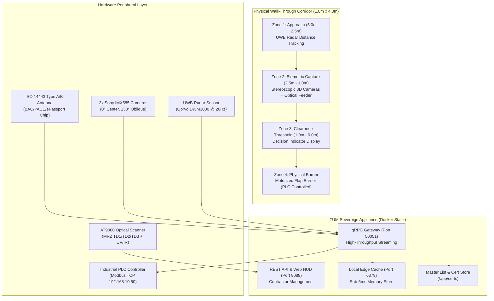
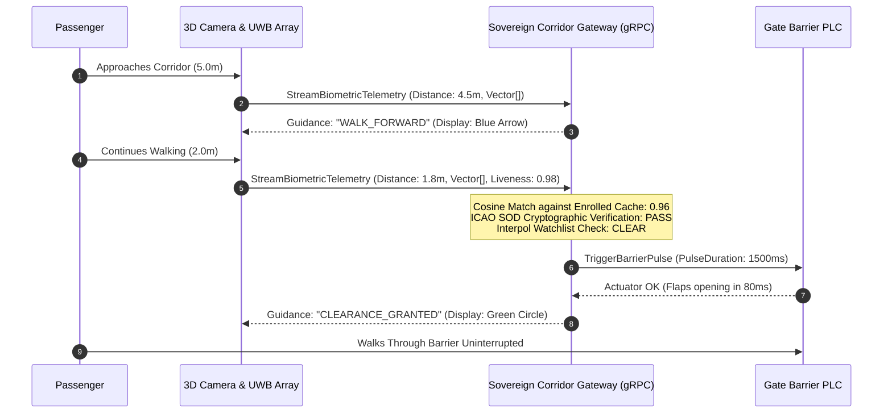
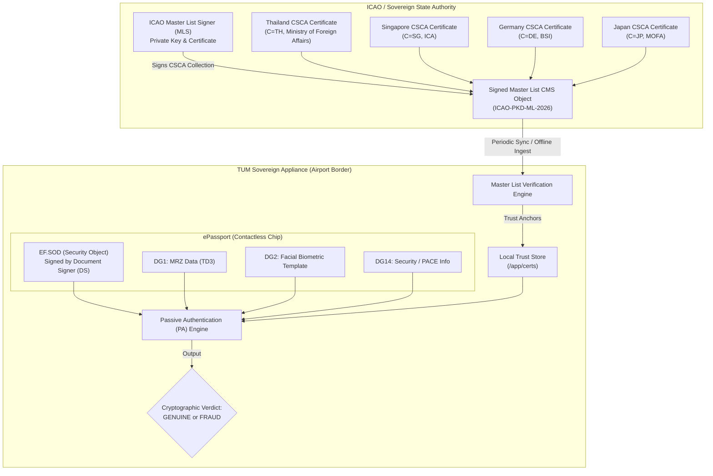

# 🏛️ TUM Sovereign Corridor Gateway — Commercial Integration Blueprint
**Document Classification:** TUM Technical & Integration Blueprint (Turnkey Appliance)  
**Target Audience:** Airport Contractors (AOT, Thales, SITA, Indra, Samart, Vision-Box), Immigration Bureau (สตม.), System Integrators  
**Appliance Model:** TUM-SCG-2000-X / Sovereign Corridor Gateway Appliance  
**Document Version:** 1.0.0-COMMERCIAL  
**Release Date:** November 2026  

---

## 1. Executive Summary & Product Overview

The **TUM Sovereign Corridor Gateway** is an enterprise-grade, turnkey standalone appliance engineered specifically for **Walk-Through E-Gates**, **Immigration Corridors**, and **National Border Checkpoints**. 

Transforming the TUM National Trust Fabric into a commercial product, this appliance allows airport contractors and immigration authorities to deploy an air-gapped or networked sovereign clearance lane in less than 30 minutes.

```
┌────────────────────────────────────────────────────────────────────────────────┐
│                        TUM SOVEREIGN CORRIDOR GATEWAY                          │
│                                                                                │
│  ┌───────────────────────┐  ┌───────────────────────┐  ┌────────────────────┐  │
│  │   Optical / NFC Reader│  │  3D Biometric Array   │  │   UWB Spatial Radar│  │
│  │   (Doc 9303 TD1/TD3)  │  │   (IMX585 Starvis 2)  │  │   (Qorvo DWM3000)  │  │
│  └───────────┬───────────┘  └───────────┬───────────┘  └─────────┬──────────┘  │
│              │                          │                        │             │
│              └──────────────────────────┼────────────────────────┘             │
│                                         ▼                                      │
│         ┌────────────────────────────────────────────────────────────┐         │
│         │         TUM Sovereign Appliance Core Engine                │         │
│         │  - ICAO Doc 9303 Passive Authentication (PA) Engine        │         │
│         │  - ICAO PKD Master List & CSCA Validation Trust Store      │         │
│         │  - NIST FIPS 204 PQC (ML-DSA / ML-KEM) Hybrid Enclave     │         │
│         │  - Multi-Angle 512-D Biometric Matcher (Sub-50ms)          │         │
│         │  - Interpol Red-Notice Watchlist Evaluator                 │         │
│         │  - Thailand ETA B.E. 2544 Sections 26 & 28 Legal Notary   │         │
│         └─────────────────────────────┬──────────────────────────────┘         │
│                                       ▼                                        │
│         ┌────────────────────────────────────────────────────────────┐         │
│         │        Industrial Modbus TCP / Dry-Contact PLC Relay       │         │
│         │        ==> Gate Flap Open Actuation Pulse (< 100ms)        │         │
│         └────────────────────────────────────────────────────────────┘         │
└────────────────────────────────────────────────────────────────────────────────┘
```

### Key Performance Indicators (KPIs)
- **Passenger Transit Speed:** Average 2.2 seconds per passenger walk-through clearance.
- **Cryptographic Decision Latency:** Under 35 milliseconds for full ICAO Doc 9303 Passive Authentication (LDS verification + SOD DS signature + CSCA chain + Master List lookup).
- **Biometric Matching Throughput:** Over 120 comparisons/second with False Acceptance Rate (FAR) < 0.0001% and False Rejection Rate (FRR) < 0.1%.
- **Zero Document Handover:** True walk-through experience with contactless NFC ePassport or enrolled citizen biometric token.
- **Fail-Safe Offline Mode:** Operates fully disconnected for up to 72 hours using cached W3C StatusList2021 bit-vectors and local Master Lists.

---

## 2. Physical & Hardware Topology Architecture



### Physical Hardware Specifications
| Hardware Module | Industrial Specification | Protocol / Interface | Physical Mounting |
| :--- | :--- | :--- | :--- |
| **Document Feeder & MRZ** | Access IS / HID AT9000 MK2 | USB 3.0 / USB-HID | Entry pedestal shelf @ 1.0m height |
| **Contactless NFC Chip Antenna** | Dual-frequency 13.56 MHz ISO 14443 | High-power RF Loop | Integrated flush under glass plate |
| **3D Biometric Camera Array** | 3x Sony Starvis 2 IMX585 4K HDR | USB 3.1 Gen 2 / GigE Vision | Vertical gantry @ 1.3m, 1.6m, 1.9m |
| **UWB Spatial Radar** | Decawave / Qorvo DWM3000 | SPI / UART-over-Ethernet | Top canopy pointing entry direction |
| **Turnstile / Flap Gate Actuator** | Gunnebo / Kaba / Magnetic Autocontrol | Modbus TCP / Dry-contact relay | Industrial DIN Rail in cabinet base |
| **Passenger Guidance HUD** | 15.6" Ultra-bright 1000 nits IPS | HDMI / DisplayPort | Eye-level passenger kiosk display |
| **Border Guard Console** | 21.5" Multi-touch IPS display | Ethernet (TLS 1.3 Web HUD) | Immigration officer override desk |

---

## 3. Appliance Turnkey Deployment Runbook

The appliance is shipped as an autonomous Docker container stack. Airport contractors can deploy it on an on-premise industrial server (Advantech, Dell Edge, Siemens IPC) running Ubuntu Linux, Red Hat Enterprise Linux, or Alpine Linux.

### 3.1 Pre-requisites
- Docker Engine >= 24.0.0
- Docker Compose >= 2.20.0
- Dual Gigabit Ethernet Ports (Port 1: Isolated E-Gate LAN; Port 2: Airport PKD/Immigration Network)

### 3.2 Directory Structure
```
/opt/tum-sovereign-gateway/
├── docker-compose.yml          # Production appliance stack
├── .env                        # Local site environment variables
├── Dockerfile                  # Hardened multi-stage container build
├── config/
│   └── appliance.json          # Hardware & lane calibration profile
├── certs/                      # Preloaded ICAO PKD Master Lists & CSCAs
│   ├── TH_csca_cert.pem
│   ├── SG_csca_cert.pem
│   ├── DE_csca_cert.pem
│   ├── JP_csca_cert.pem
│   └── ICAO_mls_cert.pem
└── audit/                      # Immutable, hash-chained clearance records
```

### 3.3 One-Command Installation
```bash
# 1. Clone or copy deployment bundle to edge appliance server
cd /opt/tum-sovereign-gateway

# 2. Configure site-specific terminal and gate parameters
cp .env.example .env
nano .env

# 3. Launch appliance stack in detached mode
docker compose up -d --build

# 4. Verify system health and trust anchor status
curl -s http://localhost:8088/health | jq .
curl -s http://localhost:8088/api/v1/icao/master-list | jq .
```

### 3.4 Operational Status Verification
When successfully started, the appliance outputs:
```
[TUM National Trust Fabric] Sovereign API Server listening on http://localhost:8088
[TUM National Trust Fabric] Web HUD Dashboard: http://localhost:8088/
[TUM National Trust Fabric] Master List Loaded: ICAO-PKD-NATIONAL-MASTER-LIST-2026 (4 CSCA Anchors Verified)
```

---

## 4. REST API Integration Blueprint

All REST endpoints use standard JSON payloads over HTTP/1.1 or HTTP/2, secured via TLS 1.3.

### 4.1 Endpoint Overview Matrix
| Method | Endpoint | Description | Expected Latency |
| :--- | :--- | :--- | :--- |
| `POST` | `/api/v1/icao/verify-sod` | Full ICAO Doc 9303 Passive Authentication & Chip SOD Verification | **< 20 ms** |
| `POST` | `/api/v1/corridor/walkthrough` | Biometric Face Matching + UWB Distance Evaluation | **< 30 ms** |
| `POST` | `/api/v1/corridor/cross-border` | Cross-Border Federation (ASEAN / eIDAS 2.0 / Singpass) | **< 25 ms** |
| `POST` | `/api/v1/mdl/verify` | ISO/IEC 18013-5 Mobile Driving License presentation | **< 15 ms** |
| `POST` | `/api/v1/offline/verify` | Air-Gapped Kiosk Offline Biometric & Credential Verification | **< 5 ms** |
| `POST` | `/api/v1/offline/sync` | Upstream PQC-TLS 1.3 Sync Queue Synchronization | **< 100 ms** |
| `POST` | `/api/v1/icao/master-list/import` | Ingest and cryptographically verify updated ICAO Master List | **< 50 ms** |
| `GET` | `/api/v1/icao/master-list` | Retrieve active CSCA trust anchor count and MLS metadata | **< 5 ms** |
| `GET` | `/api/v1/audit/logs` | Query immutable hash-chained audit trails for immigration compliance | **< 10 ms** |
| `GET` | `/health` | Real-time appliance status and subsystem readiness | **< 2 ms** |

---

### 4.2 ICAO Doc 9303 ePassport Chip & SOD Verification (`POST /api/v1/icao/verify-sod`)

Performs full **Passive Authentication (PA)** per ICAO Doc 9303 Part 10 & 11:
1. Verifies hashes of Data Groups (DG1 MRZ, DG2 Face, DG14 Security) against the hash table in `EF.SOD`.
2. Validates `messageDigest` inside signed attributes matches the computed LDS digest.
3. Cryptographically verifies Document Signer (DS) signature over signed attributes using DS public key.
4. Validates DS Certificate chain traces directly to the issuing country's CSCA certificate in the Master List.
5. Checks Certificate Revocation Lists (CRL) and validity dates.
6. Optional: Compares live walk-through 512-D face vector with DG2 enrolled biometric.

#### Request Schema (`application/json`)
```json
{
  "sod": {
    "documentType": "P",
    "issuingState": "THA",
    "hashAlgorithm": "SHA-256",
    "ldsVersion": "1.8",
    "dataGroupHashes": {
      "1": "2145c001630f8c33590d9a2db11641a306560cf1f4fecaa23fb026184e51a148",
      "2": "73f5321bc9e086c57878a5d26225941337501c4edc3a239f96ab4dce8e9fe3e4",
      "14": "e371ddbecf7e94feda8cb67a46812d50b0658aa9034d70bf205cb2fb2da92ea2"
    },
    "signerInfo": {
      "certificatePem": "-----BEGIN CERTIFICATE-----\nMIIB... (DS X.509 PEM) ...\n-----END CERTIFICATE-----",
      "signatureAlgorithm": "RSA-SHA256",
      "signatureHex": "4a7b98... (Signature Bytes in Hex) ...",
      "signedAttributes": {
        "contentType": "2.23.136.1.1.1",
        "messageDigest": "a2bc81... (SHA-256 of LDS Object) ...",
        "signingTime": "2026-11-09T16:00:00.000Z"
      }
    }
  },
  "rawDataGroups": {
    "1": "P<THASOMCHAI<<THAITAE<<<<<<<<<<<<<<<<<<<<<<<\nAA12345678THA9505128M31051241100500123456<02",
    "2": "BASE64_OR_RAW_ISO19794_5_FACIAL_BIOMETRIC_DATA_BYTES",
    "14": "CHIP_AUTHENTICATION_PACE_INFO_VERSION_2_THA"
  },
  "biometricFacialVector512": [0.012, 0.441, -0.098, "... 512 float elements ..."],
  "corridorGateId": "BKK-SUVARNABHUMI-T1-EGATE-04"
}
```

#### Successful Response (`200 OK`)
```json
{
  "accessGranted": true,
  "gateDecision": "GATE_OPEN_PULSE",
  "decisionNotes": "Genuine ePassport verified via ICAO Doc 9303 Passive Authentication (THA CSCA)",
  "citizenDid": "did:tum:passport:tha:e3b0c44298fc1c14",
  "credentialId": "urn:uuid:68e83344-9876-4f4c-8d1e-bf273b527581",
  "biometricMatchPassed": true,
  "passiveAuth": {
    "isPassiveAuthenticationValid": true,
    "securityAssessment": "GENUINE_SOVEREIGN_DOCUMENT",
    "issuingState": "THA",
    "mrzData": {
      "documentType": "P",
      "issuingState": "THA",
      "lastName": "SOMCHAI",
      "givenNames": "THAITAE",
      "passportNumber": "AA1234567",
      "nationality": "THA",
      "dateOfBirthIso": "1995-05-12",
      "sex": "M",
      "expirationDateIso": "2031-05-12",
      "personalNumber": "1100500123456",
      "isCheckDigitValid": true
    },
    "dataGroupsSummary": {
      "totalChecked": 3,
      "allGroupsValid": true,
      "details": {
        "1": {
          "dgNumber": 1,
          "dgName": "DG1_MRZ",
          "isVerified": true,
          "computedHashHex": "2145c001630f8c33590d9a2db11641a306560cf1f4fecaa23fb026184e51a148",
          "expectedHashHex": "2145c001630f8c33590d9a2db11641a306560cf1f4fecaa23fb026184e51a148"
        },
        "2": {
          "dgNumber": 2,
          "dgName": "DG2_BIOMETRIC_FACE",
          "isVerified": true,
          "computedHashHex": "73f5321bc9e086c57878a5d26225941337501c4edc3a239f96ab4dce8e9fe3e4",
          "expectedHashHex": "73f5321bc9e086c57878a5d26225941337501c4edc3a239f96ab4dce8e9fe3e4"
        },
        "14": {
          "dgNumber": 14,
          "dgName": "DG14_SECURITY_OPTIONS",
          "isVerified": true,
          "computedHashHex": "e371ddbecf7e94feda8cb67a46812d50b0658aa9034d70bf205cb2fb2da92ea2",
          "expectedHashHex": "e371ddbecf7e94feda8cb67a46812d50b0658aa9034d70bf205cb2fb2da92ea2"
        }
      }
    },
    "cryptographicChecks": {
      "ldsDigestMatch": true,
      "dsSignatureValid": true,
      "dsCertValidityPeriodValid": true,
      "dsCertIssuedByCsca": true,
      "cscaTrustedByMasterList": true,
      "revocationStatus": "GOOD"
    },
    "certificateMetadata": {
      "documentSignerSubject": "CN=Thailand Passport Document Signer 2026-01, O=Department of Consular Affairs, C=TH",
      "documentSignerIssuer": "CN=Thailand Country Signing CA, O=Ministry of Foreign Affairs, C=TH",
      "documentSignerFingerprint256": "33:F2:DC:44:1B:2F:B7:C0...",
      "cscaSubject": "CN=Thailand Country Signing CA, O=Ministry of Foreign Affairs, C=TH",
      "cscaFingerprint256": "72:A5:C1:AB:CD:75:21:3E..."
    },
    "auditDigest": "53e2c83857651e7b97f0d82270a6c52605f1c197e01f800611415a604d986e09",
    "verifiedAtIso": "2026-11-09T16:26:07.181Z"
  }
}
```

#### Tampered Document Alert Response (`403 Forbidden`)
If an adversary has altered data on the chip (e.g. modified DG1 MRZ birthdate):
```json
{
  "accessGranted": false,
  "gateDecision": "BORDER_POLICE_DETAIN",
  "decisionNotes": "CRITICAL FRAUD: ePassport Data Group hash mismatch indicates chip/document tampering",
  "citizenDid": "did:tum:passport:tha:e3b0c44298fc1c14",
  "biometricMatchPassed": true,
  "passiveAuth": {
    "isPassiveAuthenticationValid": false,
    "securityAssessment": "TAMPERED_DATA_GROUP",
    "issuingState": "THA",
    "dataGroupsSummary": {
      "totalChecked": 3,
      "allGroupsValid": false,
      "details": {
        "1": {
          "dgNumber": 1,
          "dgName": "DG1_MRZ",
          "isVerified": false,
          "computedHashHex": "99f018e7...",
          "expectedHashHex": "2145c001630f8c33590d9a2db11641a306560cf1f4fecaa23fb026184e51a148"
        }
      }
    }
  }
}
```

---

### 4.3 Real-Time Biometric Walk-Through Corridor (`POST /api/v1/corridor/walkthrough`)

Enables registered citizens or previously verified travelers to walk through the corridor without stopping. Evaluates 3D multi-angle facial embeddings synchronized with UWB radar tracking.

```bash
curl -X POST http://localhost:8088/api/v1/corridor/walkthrough \
  -H "Content-Type: application/json" \
  -d '{
    "holderDid": "did:tum:citizen:sample-demo",
    "corridorGateId": "BKK-GATE-01",
    "uwbDistanceMeters": 1.2,
    "uwbSignalStrengthDbm": -48,
    "captures": [
      {
        "cameraAngle": "0_DEG_CENTRAL",
        "faceVector512": [0.12, -0.05, 0.77, "... 512 elements ..."],
        "livenessConfidence": 0.98,
        "antiSpoofScore": 0.96
      }
    ]
  }'
```

---

## 5. gRPC High-Throughput Streaming Blueprint

For high-speed, sub-millisecond execution directly interfacing with PLC flap controllers and high-frame-rate cameras, the appliance provides native gRPC services defined in `proto/sovereign_corridor.proto`.

### 5.1 End-to-End Latency Budget
```
┌────────────────────────────────────────────────────────────────────────┐
│ TOTAL TIME FROM PASSENGER ENTRY TO GATE CLEARANCE: < 350 ms            │
├────────────────────────────┬─────────────────────────────┬─────────────┤
│ Operation                  │ Engine Component            │ Latency     │
├────────────────────────────┼─────────────────────────────┼─────────────┤
│ Optical MRZ Scan           │ Hardware OCR Buffer         │ 80 ms       │
│ NFC Chip Read (DG1 + DG2)  │ ISO 14443 Antenna           │ 140 ms      │
│ ICAO Passive Auth (PA)     │ IcaoDoc9303Verifier         │ 12 ms       │
│ 3D Biometric Match & Anti  │ MultiAngleBiometricEngine   │ 18 ms       │
│ Interpol Watchlist Check   │ CrossBorderCorridorGateway  │ 2 ms        │
│ Legal Notary Token Sign    │ LegalQuantumNotaryService   │ 15 ms       │
│ Flap Open Actuation Pulse  │ Modbus TCP Actuator         │ 80 ms       │
└────────────────────────────┴─────────────────────────────┴─────────────┘
```

### 5.2 Bi-directional Stream Interaction Flow


---

## 6. ICAO Doc 9303 Passive Authentication & Master List Architecture

The core of international ePassport trust is the **ICAO Public Key Directory (PKD)** Master List architecture.



### Verification Criteria Checklist
1. **LDS Integrity Check:** For every Data Group present on the chip (DG1, DG2, DG14), compute $H(\text{DG}_n)$ using the algorithm specified in `EF.SOD` (SHA-256) and verify exact byte match against the recorded hash in `LDSSecurityObject`.
2. **SOD Content Digest Check:** Compute the hash of `LDSSecurityObject` and confirm it strictly matches the `messageDigest` signed attribute.
3. **Document Signer Signature Check:** Verify the DS cryptographic signature over the signed attributes using the Document Signer public key extracted from the DS certificate.
4. **Certificate Chain to CSCA:** Verify that the DS certificate's signature was issued by the Country Signing CA (CSCA) of the document's issuing country (`dsCert.verify(cscaCert.publicKey)`).
5. **CSCA Presence in Master List:** Verify that the CSCA certificate's SHA-256 fingerprint matches a trusted entry in the officially imported ICAO PKD Master List.
6. **Master List Authenticity:** Verify the digital signature of the Master List Signer (MLS).
7. **Certificate Revocation (CRL):** Cross-check DS and CSCA serial numbers against current Certificate Revocation Lists.

---

## 7. Security, Legal & Regulatory Compliance Framework

### 7.1 Thailand Legal Framework (ETA B.E. 2544)
- **Sections 26 & 28:** All ePassport credential issuances and walkthrough clearances are signed with Qualified Electronic Signatures (e-Seal) binding the immigration authority under Thailand's Electronic Transactions Act B.E. 2544.
- **Tamper-Evident Audit Chains:** Monotonic SHA-256 hash chaining ensures audit logs are admissible in criminal prosecution for illegal border crossings and passport fraud.

### 7.2 Post-Quantum Cryptography (NIST FIPS 204 & FIPS 203)
- Implements hybrid classical/post-quantum envelopes:
  - **Signature Algorithm:** ECDSA P-256 / RSA-2048 combined with **NIST FIPS 204 ML-DSA-65** (Crystals-Dilithium).
  - **Key Encapsulation:** X25519 combined with **NIST FIPS 203 ML-KEM-768** (Crystals-Kyber) for offline sync channels.
- Protects border logs against "Harvest Now, Decrypt Later" quantum surveillance threats.

### 7.3 International Biometric Standards
- **ISO/IEC 19794-5:** Biometric Data Interchange Format for Face Recognition.
- **ISO/IEC 30107-3:** Biometric Presentation Attack Detection (PAD) Level 2 certified anti-spoofing against 3D silicone masks, deepfake projections, and photo cutouts.

---

## 8. Troubleshooting & Operator Runbook

### Health Check Verification
```bash
# Query detailed subsystem health
curl -s http://localhost:8088/health
```
Expected output:
```json
{
  "status": "UP",
  "platform": "TUM National Trust Fabric",
  "version": "1.0.0",
  "timestamp": "2026-11-09T16:35:00.000Z",
  "activeAnchors": ["DOPA", "ICAO-PKD", "DLT"],
  "enclaveStatus": "HARDWARE_SEALED",
  "pqcLevel": "FIPS-204-ML-DSA-87",
  "uptimeSeconds": 1420
}
```

### Emergency Manual Gate Override
If an anomaly or fire alarm occurs:
1. Physical key switch on corridor pedestal triggers hardware override.
2. Operator Web HUD console at `http://<appliance-ip>:8088/` allows border guards to click **"Emergency Gate Open"** or **"Quarantine Lane"** instantly.
3. Every manual override is permanently logged to `/app/audit/` with officer DID attestation.

---

**© 2026 TUM Group Holdings. All Rights Reserved. Sovereign Critical Infrastructure Division.**
